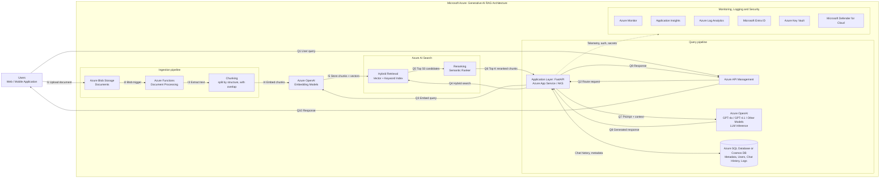

# Azure Architecture for Generative AI Applications (RAG)

Scalable, secure, highly available RAG architecture on Microsoft Azure, with chunking and reranking.

## Diagram

## Flow explanation

### Ingestion flow (runs once per document)

| Step | From → To | What happens |
|------|-----------|--------------|
| I1 | Users → Blob Storage | User uploads a document. Blob Storage is the durable source of truth for raw files. |
| I2 | Blob Storage → Azure Functions | A blob trigger fires the processing function for each new or updated file. |
| I3 | Azure Functions → Chunking | The function extracts text from the file and passes it to the chunking step. |
| I4 | Chunking → Embedding Models | Text is split into chunks along document structure (headings, paragraphs) with overlap between neighbours. Each chunk is sent to the Azure OpenAI embedding model. |
| I5 | Embedding Models → Azure AI Search | Each chunk is stored in the index with its text, its vector and metadata (source file, page, section). |

### Query flow (runs on every user question)

| Step | From → To | What happens |
|------|-----------|--------------|
| Q1 | Users → API Management | User sends a question. APIM handles authentication, throttling and routing. |
| Q2 | API Management → FastAPI | The request is forwarded to the application layer on App Service or AKS. |
| Q3 | FastAPI → Embedding Models | The query is embedded with the same model used for the chunks. Vectors from different models are not comparable. |
| Q4 | FastAPI → Azure AI Search | Hybrid search: vector similarity and keyword (BM25) matching run together and their results are merged. |
| Q5 | Hybrid Retrieval → Semantic Ranker | The top 50 candidates are passed to the semantic ranker inside Azure AI Search. |
| Q6 | Semantic Ranker → FastAPI | The ranker rescores candidates against the query and returns the top K chunks. |
| Q7 | FastAPI → Azure OpenAI | The app builds a prompt from the system instructions, the top K chunks, chat history and the user question. |
| Q8 | Azure OpenAI → FastAPI | The LLM generates a response grounded in the supplied chunks. |
| Q9 | FastAPI → API Management | The app returns the answer, ideally with source citations from chunk metadata. |
| Q10 | API Management → Users | The response is returned to the web or mobile client. |

### Supporting components

- **Azure SQL Database or Cosmos DB**: stores users, document metadata, chat history and application logs. FastAPI reads chat history before building the prompt and writes the new turn after the response.
- **Azure Monitor, Application Insights, Log Analytics**: metrics, request tracing and centralized logs for every component.
- **Microsoft Entra ID**: user authentication, plus managed identities for service to service calls.
- **Azure Key Vault**: secrets and keys for anything that cannot use a managed identity.
- **Microsoft Defender for Cloud**: security posture and threat detection.

## Why chunking and reranking

**Chunking.** Embedding a whole document produces one vector that averages many topics, so retrieval is imprecise and the result may not fit the context window. Chunks give each passage its own vector. Splitting on document structure keeps ideas intact, and overlap prevents losing context at chunk boundaries.

**Reranking.** Vector and keyword retrieval are fast but coarse. The semantic ranker reads the query and each candidate together and rescores them, which moves the truly relevant chunks to the top. Retrieving wide (50) and then reranking down to a small K gives the LLM better context with fewer tokens.
