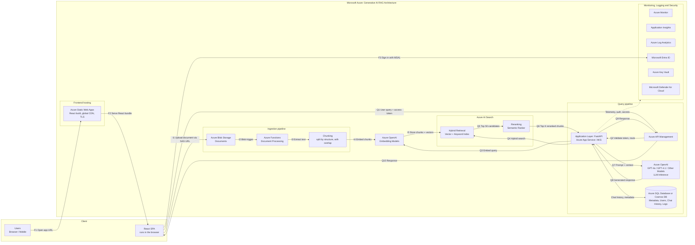

# Azure Architecture for Generative AI Applications (RAG)

Scalable, secure, highly available RAG architecture on Microsoft Azure, with a React frontend on Azure Static Web Apps, chunking and reranking.

## Diagram

## Flow explanation

### Frontend flow (runs when the user opens the app)

| Step | From → To | What happens |
|------|-----------|--------------|
| F1 | Users → Static Web Apps | User opens the app URL. Static Web Apps serves the request from its global edge network over TLS on a custom domain. |
| F2 | Static Web Apps → React SPA | The static React build (HTML, JS, CSS) is downloaded and runs in the browser. From here on, the browser talks to the backend directly. |
| F3 | React SPA → Entra ID | The SPA signs the user in with MSAL (authorization code flow with PKCE) and receives an access token scoped to the backend API. |

### Ingestion flow (runs once per document)

| Step | From → To | What happens |
|------|-----------|--------------|
| I1 | React SPA → Blob Storage | The SPA asks the API for a short-lived SAS URL, then uploads the file straight to Blob Storage. Large files never pass through FastAPI. |
| I2 | Blob Storage → Azure Functions | A blob trigger fires the processing function for each new or updated file. |
| I3 | Azure Functions → Chunking | The function extracts text from the file and passes it to the chunking step. |
| I4 | Chunking → Embedding Models | Text is split into chunks along document structure (headings, paragraphs) with overlap between neighbours. Each chunk is sent to the Azure OpenAI embedding model. |
| I5 | Embedding Models → Azure AI Search | Each chunk is stored in the index with its text, its vector and metadata (source file, page, section). |

### Query flow (runs on every user question)

| Step | From → To | What happens |
|------|-----------|--------------|
| Q1 | React SPA → API Management | The SPA sends the question with the Entra ID access token in the Authorization header. |
| Q2 | API Management → FastAPI | APIM validates the token, applies throttling and CORS, then forwards the request to App Service or AKS. |
| Q3 | FastAPI → Embedding Models | The query is embedded with the same model used for the chunks. Vectors from different models are not comparable. |
| Q4 | FastAPI → Azure AI Search | Hybrid search: vector similarity and keyword (BM25) matching run together and their results are merged. |
| Q5 | Hybrid Retrieval → Semantic Ranker | The top 50 candidates are passed to the semantic ranker inside Azure AI Search. |
| Q6 | Semantic Ranker → FastAPI | The ranker rescores candidates against the query and returns the top K chunks. |
| Q7 | FastAPI → Azure OpenAI | The app builds a prompt from the system instructions, the top K chunks, chat history and the user question. |
| Q8 | Azure OpenAI → FastAPI | The LLM generates a response grounded in the supplied chunks. |
| Q9 | FastAPI → API Management | The app returns the answer, ideally with source citations from chunk metadata. |
| Q10 | API Management → React SPA | The SPA renders the answer. Streaming the tokens (server-sent events) makes the chat feel responsive. |

### Supporting components

- **Azure Static Web Apps**: hosts the React build with a global CDN, free TLS certificates, custom domains, and preview environments per pull request through GitHub Actions or Azure DevOps.
- **Azure SQL Database or Cosmos DB**: stores users, document metadata, chat history and application logs. FastAPI reads chat history before building the prompt and writes the new turn after the response.
- **Azure Monitor, Application Insights, Log Analytics**: metrics, request tracing and centralized logs for every component. The Application Insights JavaScript SDK in the SPA links browser sessions to backend traces.
- **Microsoft Entra ID**: user sign-in for the SPA, token validation at APIM, and managed identities for service to service calls.
- **Azure Key Vault**: secrets and keys for anything that cannot use a managed identity.
- **Microsoft Defender for Cloud**: security posture and threat detection.

## Why Azure Static Web Apps for the frontend

A React SPA is static files, so it needs no server. Static Web Apps is the purpose-built service for that: CDN, TLS, custom domains and CI/CD are included, and it costs far less than running the frontend on App Service. The API stays on App Service or AKS behind API Management.

Configuration that must be in place:

- **SPA fallback**: route unknown paths to `index.html` in `staticwebapp.config.json` so client-side routing works on refresh.
- **CORS on API Management**: allow the Static Web Apps origin.
- **CORS on Blob Storage**: allow the same origin for direct SAS uploads.
- **No secrets in the bundle**: the SPA only holds the Entra ID client ID and API URL. Keys stay server side.

## Why chunking and reranking

**Chunking.** Embedding a whole document produces one vector that averages many topics, so retrieval is imprecise and the result may not fit the context window. Chunks give each passage its own vector. Splitting on document structure keeps ideas intact, and overlap prevents losing context at chunk boundaries.

**Reranking.** Vector and keyword retrieval are fast but coarse. The semantic ranker reads the query and each candidate together and rescores them, which moves the truly relevant chunks to the top. Retrieving wide (50) and then reranking down to a small K gives the LLM better context with fewer tokens.

- Added the missing return arrows from the LLM to the app and from the app back through API Management.
